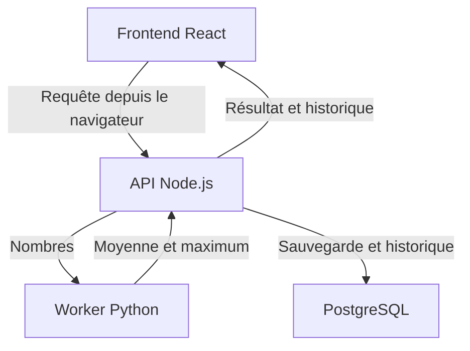

# EcoTrack Analytics

Une organisation souhaite analyser des séries de mesures et conserver les résultats. Depuis une page React, l’utilisateur lance un calcul. L’API Node.js demande au service Python de calculer la moyenne et le maximum, puis enregistre le résultat dans PostgreSQL. La page affiche le résultat et l’historique.



Le JavaScript React s’exécute dans le navigateur. Le conteneur frontend sert les fichiers de la page. Le navigateur appelle localhost:5000 ; dans Docker, l’API contacte worker et db par leur nom de service.

## Votre mission

Alizée CHAMBON

Audrey JULIEN

Groupe : B2

### 1. Identifier les services

| Dossier ou service | Technologie | Commande de lancement | Port |
|---|---|---|---|
| frontend | React et serveur Node.js | npm run build puis npm start | 3000 |
| api | Node.js Express | npm start | 5000 |
| worker | Python Flask | python app.py | 8000 |
| db | Image postgres:15-alpine | À configurer dans Compose | 5432 interne |


### 2. Tester Python avec un venv

Windows PowerShell :

```powershell
py -m venv .venv
.\.venv\Scripts\Activate.ps1
```

Linux ou macOS :

```bash
python3 -m venv .venv
source .venv/bin/activate
```

Puis :

```bash
python -m pip install -r requirements.txt
python -c "import sys; print(sys.executable)"
python app.py
```

Le chemin Python doit contenir .venv. Ouvrir http://localhost:8000/health : résultat attendu {"status":"ok"}.


### 3. Créer les images

Chaque services à son propre `dockerfile` (dans `frontend/`, `api/` et `worker/`) et un `.dockerignore` pour inclure les dépendances locals et garder les images légères.

* `frontend` (`./frontend/dockerfile`) : installe les dépendances `Node.js`, exécute npm run build pour compiler l'application React, puis lance le serveur sur le port `3000` (`npm start`).
* `api` (`./api/dockerfile`) : installe les dépendances Node.js Express et démarre le serveur sur le port `5000` (`npm start`).
* `worker` (`./worker/dockerfile`) : installe les dépendances Python depuis `requirements.txt` et lance l'API Flask sur le port `8000` (`python app.py`).
* `db` : utilise directement l'image officielle `postgres:15-alpine` sans dockerfile personnalisé.

Toutes les images sont construites automatiquement au lancement grâce à la commande :
```bash
docker compose up -d --build
```

Et elles sont arrêté grâce à la commande : 
```bash
docker compose down -v
```

### 4. Configurer Compose

Le fichier `compose.yaml` organise l'ensemble de la file (`frontend`, `api`, `worker` et `db`)

* Ports exposés vers l'hôte :

    - `frontend` : `3000:3000` (accès à l'interface React depuis le navigateur).
    - `api` : `5000:5000` (appels depuis le navigateur / tests API).
    - `worker` et `db` : aucun port publié sur l'hôte, afin de restreindre leur accès aux réseaux internes.

* Segmentation réseau :
    - `public` : relie `frontend` et `api` pour l'exposition vers l'extérieur.
    - `backend` (internal: true) : relie `api` et `worker` pour les calculs (`POST /analyze`) sans accès direct depuis l'hôte.
    - `data` (internal: true) : relie `api` et `db` (`POSTGRES_HOST=db`, port `5432`), isolant PostgreSQL du `worker` et du `frontend`.   
    
* Dépendances et santé (healthcheck / depends_on) :
    - `db` vérifie sa disponibilité avec `pg_isready -U etudiant -d appdb`.
    - `worker` vérifie son endpoint `/health` sur le port `8000`.
    - `api` attend que db et worker soient `service_healthy`, et `frontend` attend `api`.
    
* Persistance des données : le volume `db-data` est monté sur `/var/lib/postgresql/data` dans `db` afin de conserver l'historique des analyses après un arrêt de la pile.

### 5. Ajouter le secret

Le mot de passe secret n'est pas écrit en claire dans `compose.yaml` et est placé dans `.gitignore`

* Le secret `db_password` est déclaré dans `compose.yaml` à partir du fichier local `./db_password.txt` (qui est ignoré via `.gitignore`) et monté dans `db` et `api` sous `/run/secrets/db_password`.
* Les services `db` et `api` utilisent `POSTGRES_PASSWORD_FILE=/run/secrets/db_password` pour lire le mot de passe au démarrage.

Recréer le secret après clonage du dépôt :

1. Créer un fichier à la racine nommé : `db_password.txt`
2. Écrivez votre mot de pass dedans en un seul mot, sans espace inutiles.
3. Vous pouvez maintenant lancer votre `docker compose up -d --build`

### 6. Lancer et vérifier

À la racine, après création des fichiers Docker :

```bash
docker compose config -q
docker compose up -d --build
docker compose ps -a
```

Ouvrir http://localhost:3000 pour l’interface et http://localhost:5000/status pour vérifier les trois services backend.


Si nécessaire :

```bash
docker compose logs api
docker compose logs worker
docker compose logs db
docker compose logs frontend
```

### 7. Compléter le dépôt et remettre

Inclure le code fourni, les trois Dockerfiles, les .dockerignore, compose.yaml, requirements.txt, .gitignore et ce README complété.

Ajouter ici :

- Les noms du binôme et le groupe.
- Vos commandes de lancement et d’arrêt.
- Vos preuves : commande ou action, résultat observé et explication.
- Les vérifications du calcul, de la persistance, des réseaux et du secret.

Exclure db_password.txt, .env, .venv et node_modules. Après un nouveau clonage, un lecteur doit pouvoir recréer le secret et démarrer l’application.

Déposer le lien du dépôt GitLab dans le devoir Moodle avant l’échéance annoncée. Donner accès à l’enseignante.

### Endpoints fournis

| Service | Méthode et chemin | Rôle |
|---|---|---|
| worker | GET /health | Vérifier Python |
| worker | POST /analyze | Recevoir {"numbers":[10,20,30]} et calculer |
| api | GET /health | Vérifier le processus Node.js |
| api | GET /status | Vérifier PostgreSQL et worker |
| api | POST /analyze | Calculer via Python et enregistrer |
| api | GET /history | Lire les 50 derniers résultats |
